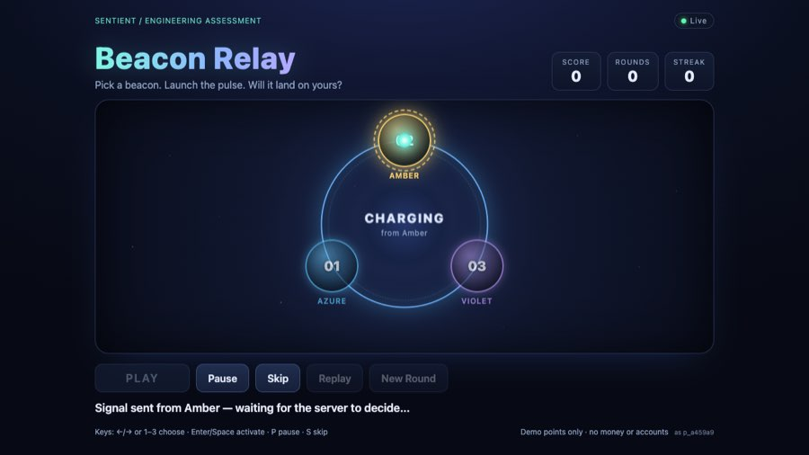
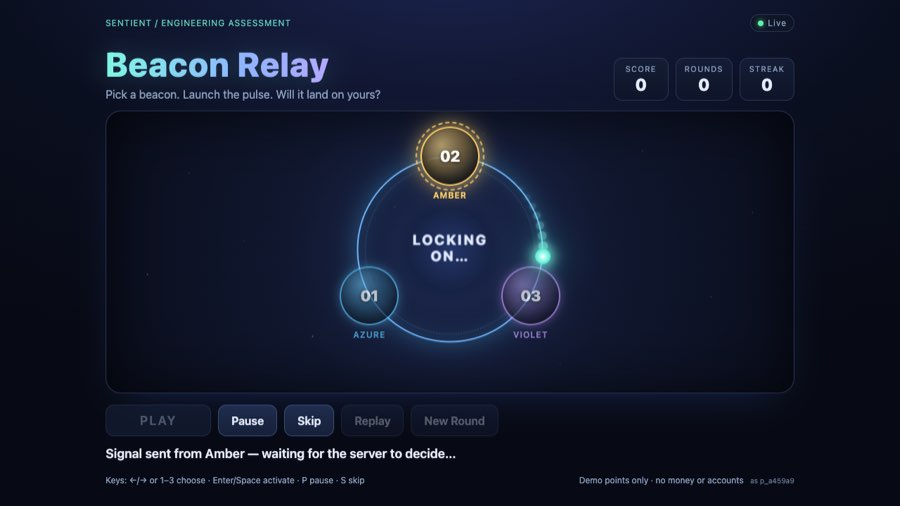
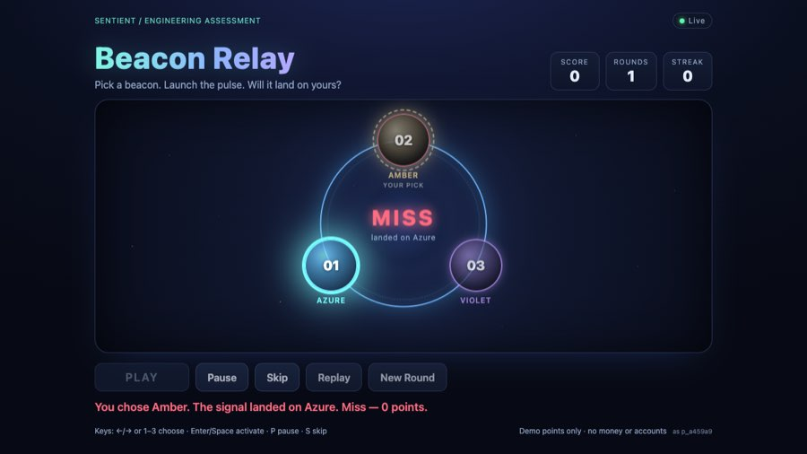
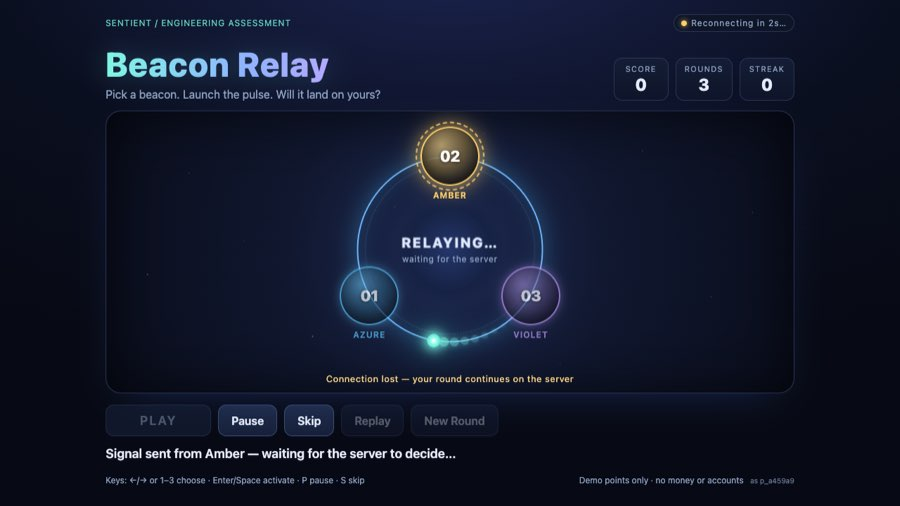
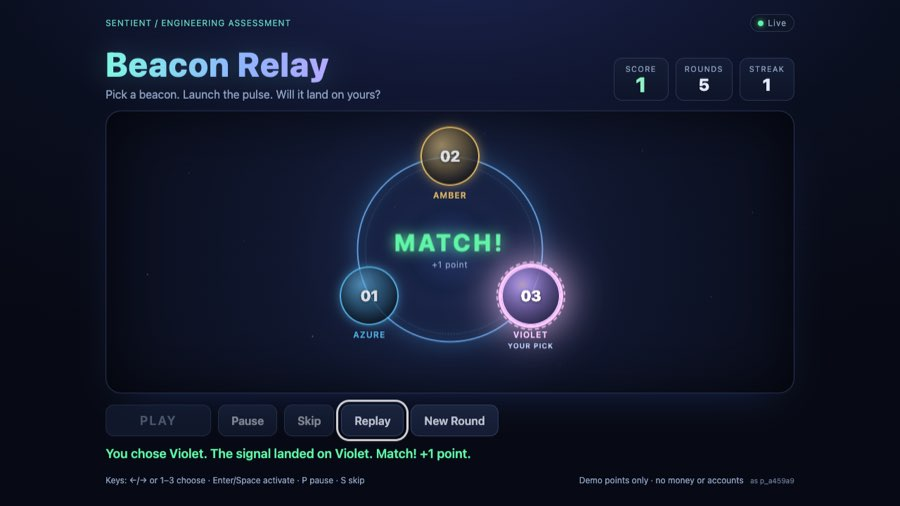
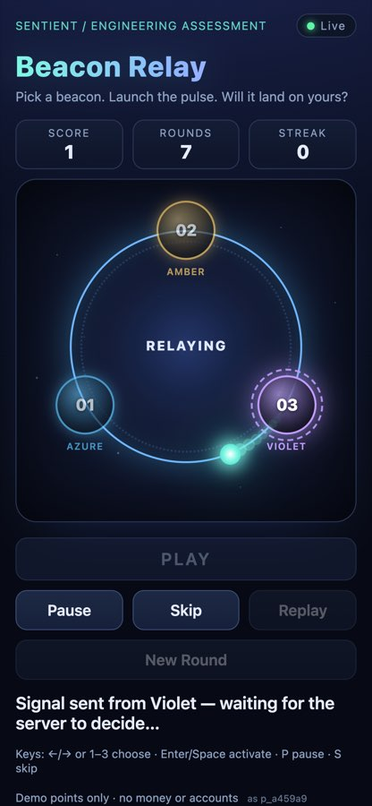
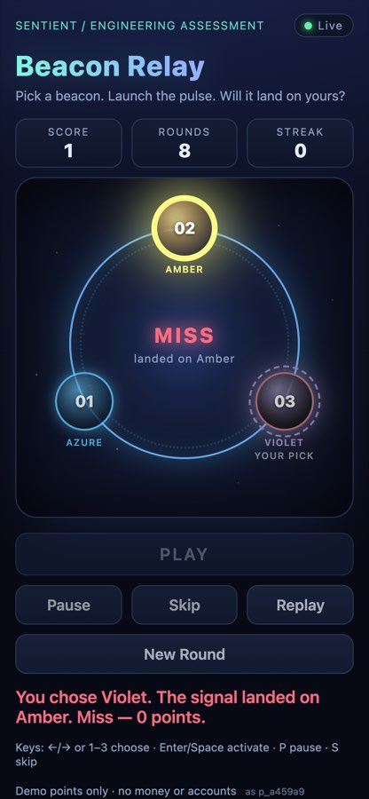

# Manual evidence

**Browser:** Google Chrome 155.0.8059.40 (headless, macOS 26 / Darwin 25.4), driven over the
Chrome DevTools Protocol by `submission/tools/browser-e2e.mjs` against a real
`node submission/start.mjs` (default ROUND_DELAY_MS=1200, GRPC_TIMEOUT_MS=300).
The script clicks and types in the real page and checks results against the server's event log.

| Case | Viewport | Result |
|---|---|---|
| Select Amber, Play, reveal | 1280×720 | PASS: pulse orbits the circular ring and decelerates onto the server target; 1.8–3.0 s presentation after the server result (backend delay is 1.2 s on top) |
| Score equals server score | 1280×720 | PASS |
| Replay | 1280×720 | PASS: no POST sent, no new events, score unchanged, same outcome |
| 8 rapid Play clicks | 1280×720 | PASS: exactly one round (2 events) |
| Refresh 400 ms into a round | 1280×720 | PASS: same roundId resumed, no extra round; reload after reveal shows the same result/score |
| Connection loss during animation (server SIGKILLed, restarted 1.5 s later with same DATA_DIR) | 1280×720 | PASS: shows "Reconnecting…" and "Connection lost — your round continues on the server"; no result invented; revealed the server's result after restart; UI score equals server total |
| Keyboard only (focus beacon, →, Tab, Enter) | 1280×720 | PASS: chose the arrowed beacon, focus ring visible, round played |
| `prefers-reduced-motion: reduce` | 1280×720 | PASS: no orbit/trail/sparks, pulse glides core → target (0.55 s after the result), same outcome |
| Pause during travel for 2 s while server completes | 1280×720 | PASS: presentation held ("Resume" shown), no reveal; Skip then revealed immediately |
| Mobile layout + play | 390×844 @3x | PASS: beacons inside stage, no horizontal scroll, round played |
| Reload: loader covers first paint (sampled every 25 ms) | 1280×720 | PASS: no visible frame with unpositioned beacons or default numbers; loader hides once restored + connected (≤ 1.5 s if offline) |
| Page-wide keys with nothing focused (`3`, Enter) | 1280×720 | PASS: plays Violet. Added after a Safari report: Safari does not focus buttons on click/Tab |
| Console errors / uncaught exceptions | all | none |

Reproduce: `node submission/tools/browser-e2e.mjs . /tmp/beacon-shots` (macOS with Google
Chrome installed; uses ports 4471/4472/9333).

## Screenshots (`submission/demo/`)

| Selection → charge | Travel (waiting for server) | Result |
|---|---|---|
|  |  |  |

| Connection lost mid-round | Keyboard play | Mobile travel | Mobile result |
|---|---|---|---|
|  |  |  |  |

## Not tested / limitations

- **Safari and Firefox:** not exercised (Safari is installed but was not automated; Firefox is
  not installed). *Candidate: do a quick manual Safari pass if time allows and update this line.*
- **Real devices:** none. Mobile is Chrome device emulation (390×844, DPR 3).
- **Headed smoothness:** frame pacing was judged from the timeline design and screenshots, not
  from a recording on a physical display. *Candidate: optionally record a short screen capture
  in a headed browser and link it in the PR.*
- **Background tab** behavior was verified by unit test (frame delta clamp), not manually.
