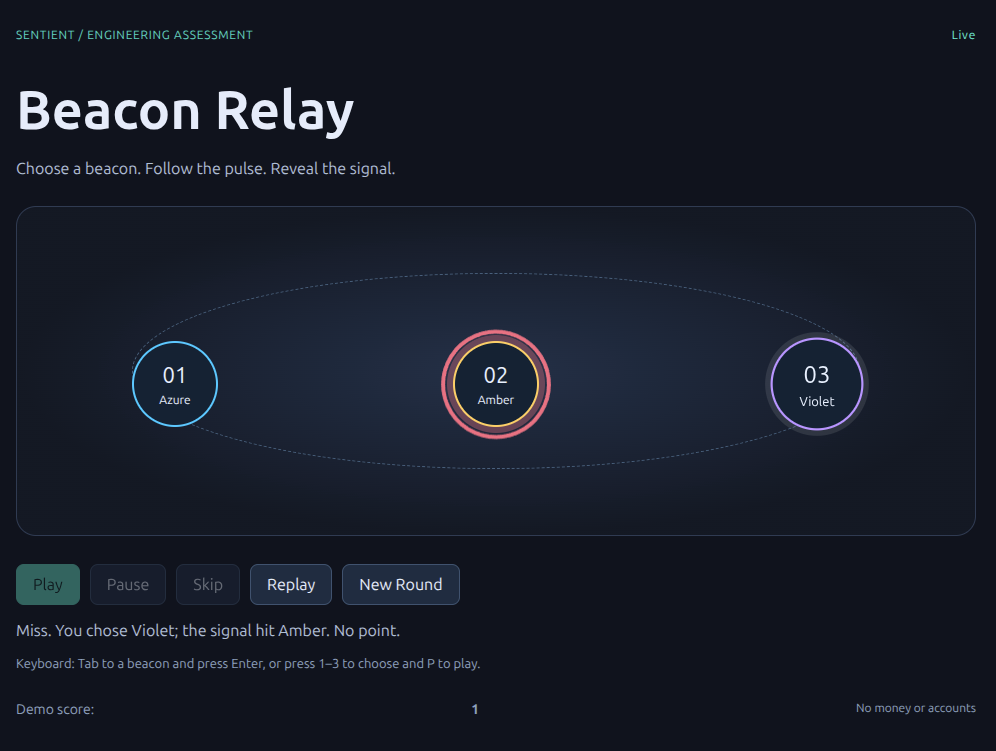

# Manual evidence

**Environment:** Chrome 142 (desktop, Linux 6.8), real server via `node submission/start.mjs`.
Node 26.9, Go 1.27.1 (module targets Go 1.26).

| Case | How | Result |
|---|---|---|
| Desktop 1280×720+ | Played full rounds | ✅ charge → waiting sweep → eased travel to the **server** target → burst; text result + score |
| Mobile 390×844 | Page loaded in a 390×844 frame (window could not be resized) | ✅ no horizontal scroll, beacons inside stage, controls wrap, canvas sized to stage |
| Keyboard-only | `1`–`3` to choose, `P` to play; Tab + Enter on beacons | ✅ visible focus; focus returns to beacon after New Round |
| Reduced motion | DevTools → Rendering → `prefers-reduced-motion: reduce`, reload | ✅ no orbit, short fade on target, same outcome (checked by candidate) |
| Rapid clicks | Double Play | ✅ one `requestId`, one round |
| Pause / Resume | Paused 2 s mid-reveal | ✅ presentation froze, server unaffected, resumed and finished |
| Skip | During waiting and during reveal | ✅ waits for the server, then reveals immediately |
| Replay | After reveal | ✅ same result, 0 `/rounds` requests, score unchanged |
| Refresh during round | Reload while `pending` | ✅ same `requestId` resubmitted, server has one accepted + one completed |
| Connection loss during animation | SIGKILL of server mid-round, restart | ✅ "Reconnecting…", stays pending (no invented result), auto-reconnect ~3 s after restart, pending round completed by recovery, cursor = last server sequence, score not double-counted |
| Background tab | Tab hidden mid-reveal | ✅ animation paused (no extra loops), resumed and finished with the correct result when visible |
| choice 0 = target 0 | Occurred naturally | ✅ "Match, +1" (client restores proto3-omitted `choice`) |

Bug found during this pass and fixed: the landed pulse covered the target beacon's
label; it is now absorbed into the impact burst.

**Untested:** Firefox, Safari, real mobile devices, high-DPI display (code renders at
`devicePixelRatio`, observed only at DPR 1).
